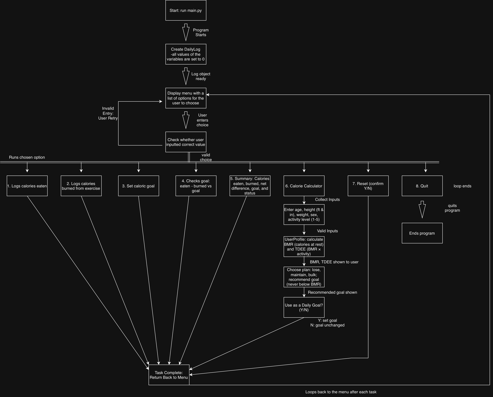

# Calorie Tracker

A Python command-line program for tracking daily calories eaten and burned, setting a calorie goal, and getting a recommended goal from a built-in calorie calculator.

## The Problem

Keeping track of calories has been a challenge for me, especially as someone who works out consistently while trying to lose weight and gain muscle. Many apps require a paid subscription or have a cluttered interface, so I wanted to build a simple application that lets people like me track their daily calories, set a goal, and quickly see whether they are on track or going over their limit.

## How It Works

The program is a menu-driven command-line app. The user can:

- **Log calories eaten** from meals and snacks, added to a running daily total
- **Log calories burned** from exercise
- **Set a daily calorie goal**, which replaces any previous goal
- **Check the goal:** the program calculates net calories (eaten − burned), compares them to the goal, and reports how far under or over the user is
- **View a daily summary** of calories eaten, calories burned, net calories, the goal, and current status
- **Use the calorie calculator:** enter age, height, weight, sex, activity level, and a plan (lose, maintain, or bulk) to get an estimated BMR, TDEE, and recommended daily goal, which can be set as the daily goal
- **Reset all values** to start a new day, with a confirmation prompt to prevent accidental resets
- **Quit** the program

The menu repeats after every action until the user quits. Invalid input, such as letters, negative numbers, empty input, or invalid menu choices, is rejected without crashing the program.

The calculator uses the Mifflin-St Jeor equation for BMR, multiplies it by a standard activity factor to get TDEE, then adjusts for the plan (−500 to lose, +0 to maintain, +250 to bulk). It never recommends a goal below the user's BMR. These numbers are estimates, not medical advice.

The code is split into three files:

- `daily_log.py` contains the `DailyLog` class, which stores and calculates the day's data.
- `user_profile.py` contains the `UserProfile` class, which stores the user's details and calculates BMR, TDEE, and the recommended goal.
- `main.py` handles the menu, user input, validation, and output.



The full feature breakdown is in the [Eisenhower Matrix](docs/eisenhower_matrix.pdf).

## Tech Stack

- **Language:** Python 3
- **Libraries:** none (Python standard library only)
- **External tools:** Git, GitHub, VS Code
- **Data storage:** none; data is kept in memory and cleared when the program exits

## Setup

1. Make sure Python 3 is installed. Check with:

   ```bash
   python3 --version
   ```

   If it isn't installed, download it from [python.org](https://www.python.org/downloads/). Nothing else needs to be installed.

2. Clone the repo and move into it:

   ```bash
   git clone https://github.com/arav-barman/CS193-Final-Project.git
   cd CS193-Final-Project
   ```

3. Run the program:

   ```bash
   python3 main.py
   ```

## Usage

Example session (the menu is shown once; it reappears before every choice):

```
1. Log calories eaten
2. Log calories burned
3. Set daily goal
4. Check goal
5. Summary
6. Calorie Calculator
7. Reset
8. Quit

Choose an option: 6
Enter your age in years: 20
Enter your height (feet): 5
Enter your height (remaining in inches): 10
Enter your weight in pounds: 170
Enter your sex (male/female): male

Activity level:
1. Sedentary (little or no exercise)
2. Lightly active (1-3 days/week)
3. Moderately active (3-5 days/week)
4. Very active (6-7 days/week)
5. Extremely active (physical job + training)
Enter your activity level (1-5): 3

BMR (Calories Burned at Rest): 1787
TDEE (Estimated Calories to Maintain Weight): 2770

What is your plan? (lose/maintain/bulk): lose
Recommended Daily Goal: 2270 calories
Note: these are estimates, not medical advice.

Would you like to use this recommendation as your daily goal? (Y/N): y
Daily Goal: 2270 calories

Choose an option: 1
Enter the number of calories you ate: 2000

Choose an option: 2
Enter the number of calories you burned: 200

Choose an option: 4
Net Calories: 1800 (2000 eaten - 200 burned)
You have met your goal! You are 470 calories under your 2270 calorie goal.

Choose an option: 5

--- Daily Summary ---
Current Calories Eaten:  2000
Current Calories Burned: 200
Net Calories:            1800
Goal:                    2270
Status: You are 470 calories under your goal

Choose an option: 7
Are you sure you want to reset all values? (Y/N): y
All values have been reset.

Choose an option: 8
Goodbye!
```

Invalid input is caught and asked again:

```
Choose an option: 1
Enter the number of calories you ate: abc
Please input a number

Enter the number of calories you ate: -500
Please enter a number 0 or greater

Enter the number of calories you ate: 500
```

## Roadmap

MVP ("Do" quadrant):

- [x] Log calories eaten and burned
- [x] Set a daily calorie goal
- [x] Check net calories against the goal
- [x] Command-line menu
- [x] Input validation and error handling
- [x] Daily summary
- [x] Reset all values (added during the build)

Planned features ("Schedule" quadrant of my Eisenhower Matrix):

- [x] Calorie calculator that recommends a daily goal based on age, height, weight, sex, activity level, and plan
- [ ] Saved history so data carries over between sessions
- [ ] Weekly summary of average net calories and days the goal was met
- [ ] Tkinter GUI to replace the command-line interface

## Demo

[Video walkthrough](https://youtu.be/iku-FhbZYos)

## Author

Arav Barman · [GitHub](https://github.com/arav-barman)