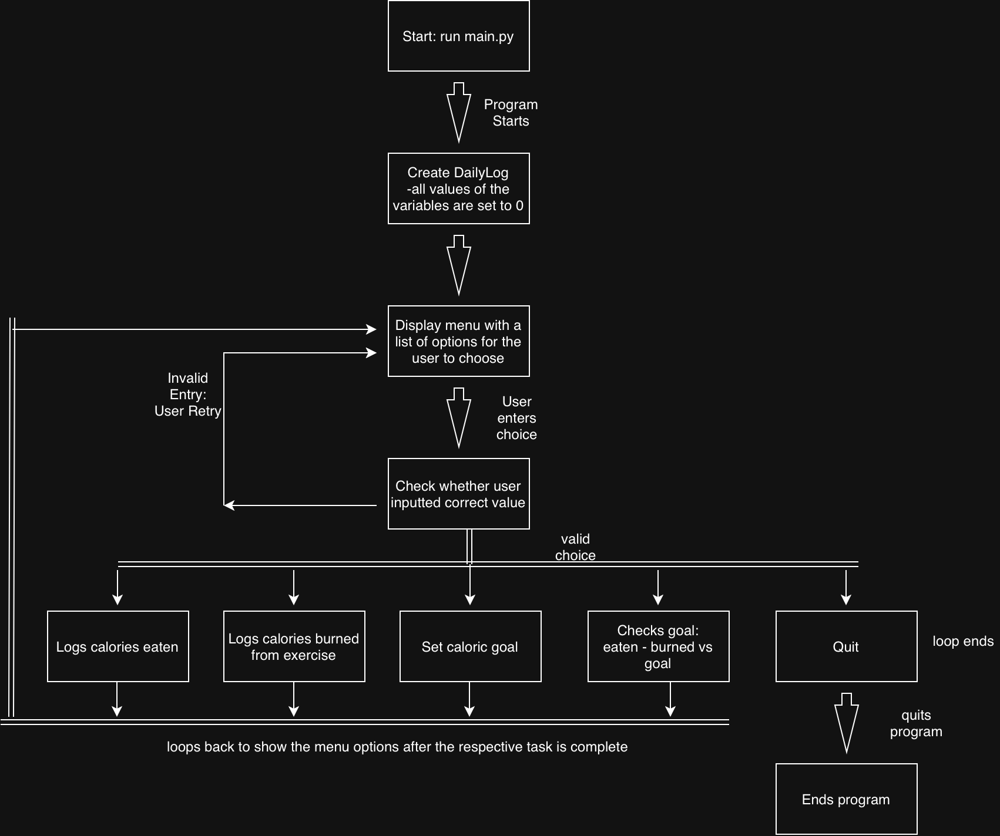

# Calorie Tracker

A program for tracking daily calories eaten and burned, setting a calorie goal, and checking whether you met it.

## The Problem

Keeping track of calories has been a challenge for me, especially as an individual that works out consistently who is trying to lose weight and gain muscle. With different apps requiring a paid subscription or having a terrible UI, I wanted to build a simple application that lets users, such as people like me, who wants to track their daily calories, set a goal, and quickly see whether they are on track for that goal or will go over the limit. 

## How It Works

Version 1.0 (the MVP) is a menu-driven command-line program. The user can:

- **Log calories eaten** from meals and snacks
- **Log calories burned** from exercise
- **Set a daily calorie goal**
- **Check the goal:** the program calculates net calories (eaten − burned), compares them to the goal, and reports whether the goal was met and by how much
- **Quit** the program from the menu

The menu repeats after every action until the user quits, and invalid input (negative numbers, non-numeric values, or invalid menu choices) is rejected without crashing the program.



The full feature breakdown is in the [Eisenhower Matrix](docs/eisenhower_matrix.pdf)

## Tech Stack

- **Language:** Python 3
- **Libraries:** none for the MVP (Python standard library only)
- **External tools:** Git, GitHub, VS Code

## Setup

You only need Python 3 installed. Check with:

```bash
python3 --version
```

Then clone the repo:

```bash
git clone https://github.com/arav-barman/CS193-Final-Project.git
cd CS193-Final-Project
```

## Usage

Run the program:

```bash
python3 main.py
```

Example session:

```
1. Log calories eaten
2. Log calories burned
3. Set daily goal
4. Check goal
5. Quit
Choose an option: 3
Daily goal: 2000

Choose an option: 1
Calories eaten: 2300

Choose an option: 2
Calories burned: 400

Choose an option: 4
Net calories: 1900 (2300 eaten - 400 burned)
You met your goal! You are 100 calories under your 2000 calorie goal.

Choose an option: 5
Goodbye!
```

## Roadmap

Planned features from the "Schedule" quadrant of my Eisenhower Matrix:

- [ ] Calorie calculator that recommends a daily goal based on the user's height and weight 
- [ ] Utilizing the Tkinter module to create a GUI
- [ ] A saved history that shows the user information of their calories burned/intake and whether if they have achieved their goal or not 

## Author

Arav Barman · [GitHub](https://github.com/arav-barman)